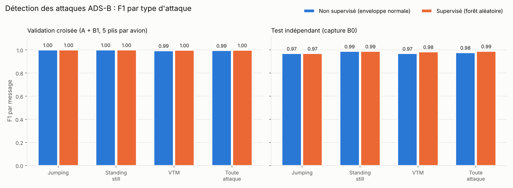
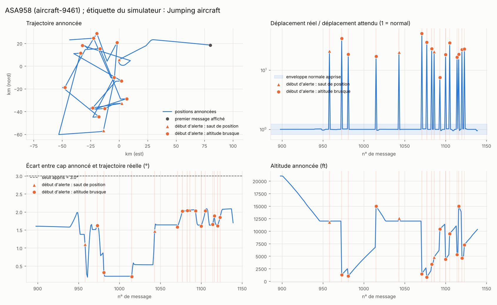
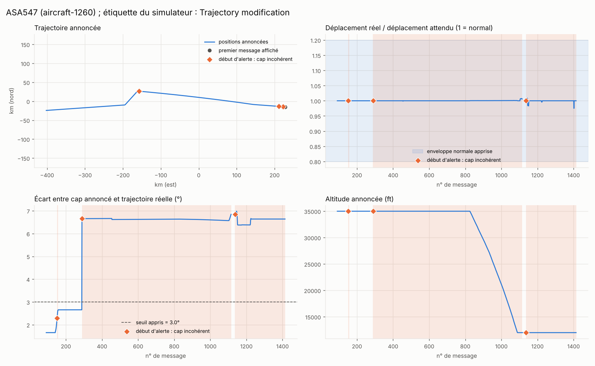
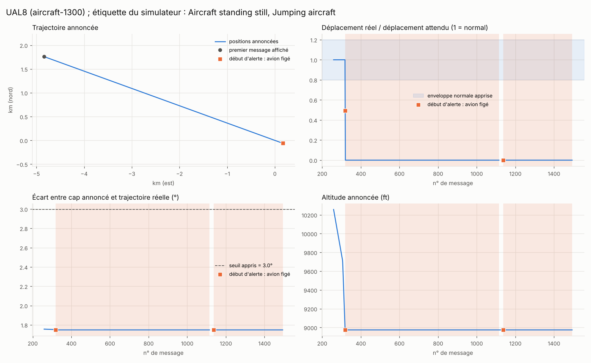

# INF6103 – Détection d'attaques ADS-B (OpenScope-sec)

Projet de session, INF6103 *Cybersécurité des infrastructures critiques*, Polytechnique Montréal, automne 2026.
Équipe 2 (aéronautique) : Louis (LouisMp), Imane Ahmed Robleh, Emilie Côté, Lutchmee Devi Gopee.

Le protocole ADS-B diffuse en clair, sans authentification ni contrôle d'intégrité, la position, le cap,
la vitesse et l'altitude des avions. Nous avons simulé trois attaques avec le simulateur
[OpenScope-sec](https://github.com/RiccardoCestaro/OpenScope-sec) (Cestaro et al., ARES 2023) et comparé deux
détecteurs qui analysent les messages ADS-B exportés par le simulateur :

| Attaque (nom dans le simulateur) | Ce qui est falsifié dans le message | Ce que le détecteur voit |
|---|---|---|
| **Jumping aircraft** | position (et altitude) remplacée par un point aléatoire près de l'aéroport | déplacement impossible vu la vitesse annoncée, altitude brusque |
| **Aircraft standing still** | position et altitude figées, vitesse annoncée inchangée | vitesse > 0 mais aucun déplacement |
| **Trajectory modification (VTM)** | cap annoncé décalé (en cloche, puis plateau) ; la position reste vraie | écart cap annoncé / trajectoire réelle |

## Les deux modèles

Les deux utilisent les **mêmes 5 variables physiques**, calculées pour chaque message d'un avion en vol :

| Variable | Définition | Normal | Sous attaque |
|---|---|---|---|
| `pas_norm` | déplacement réel / déplacement attendu d'après la vitesse sol annoncée (corrigé du time warp) | ≈ 1 | ≫ 1 (saut), ≈ 0 (figé) |
| `fige_run` | messages consécutifs sans déplacement alors que la vitesse annoncée > 0 | 0 | ≥ 3 |
| `d_cap` | variation de l'écart cap/trajectoire sur 8 messages, hors virages | < 0,4 | rampe du VTM |
| `d_alt` | variation d'altitude par message (ft, corrigée du time warp) | < 30 ft | saut d'altitude |
| `cap_abs` | écart absolu cap annoncé / trajectoire sol (°) | < 2° (dérive due au vent) | plateau du VTM (≈ 5°) |

| | **Non supervisé** – `detecteur_adsb.py` | **Supervisé** – `supervise_adsb.py` |
|---|---|---|
| Apprend sur | trafic normal seulement | exemples étiquetés des 3 attaques + normal |
| Méthode | enveloppe normale : seuil = 1,5 × la valeur extrême vue en vol normal (avec un plancher physique) | forêt aléatoire (150 arbres, classes équilibrées) |
| Sortie | alerte + motif lisible (« saut de position », « avion figé », « cap incohérent », « altitude brusque ») | classe prédite + probabilité d'attaque |
| Atout | détecte aussi une attaque jamais vue si elle viole la physique | type d'attaque mieux reconnu, VTM détecté plus tôt |
| Modèle fourni | `modeles/modele_normal.json` | `modeles/modele_supervise.joblib` |

## Installation et utilisation

```bash
pip install -r requirements.txt

# Reproduire tous les résultats (≈ 2 min) : réentraîne les 2 modèles, écrit resultats/
python experiences.py

# Détecter sur une nouvelle capture (CSV « Download ads-b » d'OpenScope-sec, tous les avions)
python detecteur_adsb.py detecter ma_capture.csv --modele modeles/modele_normal.json
python supervise_adsb.py detecter ma_capture.csv --modele modeles/modele_supervise.joblib

# Réentraîner sur d'autres captures
python detecteur_adsb.py entrainer data/capture_A_normal.csv.gz data/capture_B1_entrainement.csv.gz
python supervise_adsb.py entrainer data/capture_A_normal.csv.gz data/capture_B1_entrainement.csv.gz
```

Démo en direct : `demo_live.ipynb`. On télécharge le CSV dans le simulateur, on met son chemin dans `CSV_LIVE`,
puis on exécute les cellules ; les deux modèles sont comparés sur la capture.

`modele_supervise.joblib` est un pickle produit avec scikit-learn 1.9 : si votre version diffère, relancez
`python experiences.py` pour le régénérer. Ne chargez que des fichiers `.joblib` de confiance.

## Données

Trois captures OpenScope-sec à l'aéroport **KSEA** (Seattle), compressées dans `data/` :

| Fichier | Contenu | Rôle |
|---|---|---|
| `capture_A_normal.csv.gz` | 188 337 messages, 329 avions, aucune attaque | apprentissage du trafic normal |
| `capture_B1_entrainement.csv.gz` | 166 574 messages, 262 avions ; Jumping, Standing still, VTM (poids 1/1/1, 50 % des avions), réglages fixés en début de partie | entraînement / validation croisée |
| `capture_B0_test.csv.gz` | 152 895 messages, 301 avions ; mêmes attaques, mais réglages modifiés en cours de partie | **test indépendant** (autre partie) |

Réglages de B1 (fichier `log.txt` du simulateur) : probabilité de saut *Very high*, rayon *Small*, VTM max 5°,
pente par défaut. Chaque ligne du CSV est un message ADS-B ; le simulateur écrit un message par avion toutes les
40 mises à jour, sans colonne de temps (les retards sont donc mesurés en **messages**).

## Protocole d'évaluation

* **Vérité terrain « effective »** (`evaluation_adsb.py`). La colonne `attackType` du simulateur indique qu'un avion
  est *désigné* pour une attaque, pas que l'attaque a produit un effet : un avion « Jumping » ne saute qu'une fois
  entré dans l'espace aérien, et entre deux sauts ses messages sont normaux ; le gel « Standing still » démarre à un
  instant aléatoire. Un message compte comme attaqué s'il est étiqueté **et** que l'effet a eu lieu (saut > 3 × le
  déplacement attendu ou > 500 ft ; gel à partir du premier message immobile ; VTM : tout message étiqueté). Le
  normal = les avions jamais étiquetés. Le reste (« zone grise ») est exclu des métriques par message.
* **Validation croisée** à 5 plis **groupée par avion** sur A + B1 : un vol est entièrement en entraînement ou
  entièrement en test.
* **Test indépendant** : modèles entraînés sur A + B1, évalués sur B0.
* Le non supervisé n'apprend que sur les avions normaux (les avions « normaux » au comportement physiquement
  impossible sont écartés automatiquement).

## Résultats

Tableaux complets (par message, par avion, matrices de confusion) : [`resultats/RESULTATS.md`](resultats/RESULTATS.md)
et fichiers CSV dans `resultats/`.

### Test indépendant (B0)

| Modèle | Attaque | Précision | Rappel | F1 | Avions détectés (effet) | Retard médian (msgs) |
|---|---|---|---|---|---|---|
| Non supervisé | Jumping | 0,940 | 1,000 | 0,969 | 51/51 | 0 |
| Non supervisé | Standing still | 0,976 | 1,000 | 0,988 | 22/22 | 0 |
| Non supervisé | VTM | 1,000 | 0,939 | 0,969 | 83/83 | 4 |
| Non supervisé | **Toute attaque** | **0,999** | **0,957** | **0,977** | – | – |
| Supervisé | Jumping | 0,940 | 1,000 | 0,969 | 51/51 | 0 |
| Supervisé | Standing still | 0,976 | 1,000 | 0,988 | 22/22 | 0 |
| Supervisé | VTM | 1,000 | 0,967 | 0,983 | 83/83 | 2 |
| Supervisé | **Toute attaque** | **0,999** | **0,979** | **0,989** | – | – |

Fausses alertes sur les avions jamais attaqués : **2,73 pour 1000 messages (2 avions sur 27)** pour les deux modèles.
Ces 2 avions sont une **collision en vol** dans le simulateur (même point, même altitude, puis chute verticale
sans déplacement horizontal) : une vraie anomalie, mais pas une attaque.

### Validation croisée (A + B1)

| Modèle | Précision | Rappel | F1 | Fausses alertes / 1000 msgs normaux | Avions normaux avec fausse alerte |
|---|---|---|---|---|---|
| Non supervisé | 1,000 | 0,989 | 0,994 | 0,00 | 0/346 |
| Supervisé | 1,000 | 0,996 | 0,998 | 0,005 | 1/346 |



### Lecture des résultats

* Les deux modèles détectent **tous les avions dont l'attaque a eu un effet** (validation croisée et test).
* Le supervisé détecte le VTM **plus tôt** (2 messages contre 4 en médiane) : il apprend un seuil d'écart de cap
  plus bas que l'enveloppe prudente du non supervisé. Le non supervisé reste préférable face à une attaque inconnue,
  car il n'a besoin d'aucun exemple d'attaque.
* Les erreurs de type en test (VTM prédit « Jumping » ou « Standing still ») viennent des **étiquettes** du
  simulateur : quand on change un réglage, un avion déjà figé ou en train de sauter garde l'étiquette VTM pendant
  ~16 messages (rampe de fin du VTM).
* Rappel par rapport aux **étiquettes brutes** : seulement 19/58 avions « Jumping » et 14/39 « Standing still »
  (B1) ont réellement subi l'attaque pendant la capture ; les autres n'étaient pas encore éligibles (pas encore
  entrés dans l'espace aérien).
* **Circularité** : la vérité terrain repose sur des critères physiques simples, que le supervisé peut réapprendre ;
  ses scores sont donc optimistes. Les mesures les plus indépendantes sont le taux de fausses alertes et la
  détection par avion.

| Exemple Jumping | Exemple VTM | Exemple Standing still |
|---|---|---|
|  |  |  |

## Ce que nous avons appris sur OpenScope-sec

* **Jumping et Standing still ne touchent que les arrivées**, après leur premier appel au contrôleur (`callUp`).
  Les départs et survols étiquetés ne subissent rien. Le VTM n'a pas cette restriction.
* **Jumping à EGCC (Manchester)** : le centre de l'aéroport est stocké en degrés-minutes-secondes (texte) ; le calcul
  du saut donne `NaN` et l'avion **disparaît** au lieu de sauter. À KSEA (centre numérique), les sauts sont visibles.
  C'est pourquoi nos captures utilisent KSEA.
* **Changer un réglage en cours de partie** retire et redistribue les étiquettes de tous les avions, alors qu'un
  avion figé reste figé : les étiquettes deviennent bruitées. Il faut fixer les réglages au début.
* Les réglages faits avant un rechargement de la page ne sont pas toujours appliqués au moteur : vérifier les lignes
  « Changed … » dans `log.txt`.
* Le journal ADS-B est vidé après ~100 000 mises à jour (≈ 20 min après le chargement de la page) : télécharger avant.
* Il faut le CSV de **tous** les avions : le détecteur estime le time warp et les pauses à partir de la population.

## Limites

* Simulation logicielle au niveau des messages, sans couche radio 1090 MHz ni récepteurs multiples.
* Attaques programmées par le simulateur, pas adaptatives ; un attaquant qui respecte la physique (vitesse et cap
  cohérents) ne serait pas vu par ces variables. Ghost injection n'est pas couvert.
* `cap_abs` dépend du vent de l'aéroport : un VTM plus petit que la dérive normale n'est vu que pendant sa rampe.
* Les avions au sol (vitesse < 50 kt) ne sont pas évalués.
* Un seul aéroport (KSEA) et trois captures : les seuils doivent être réappris pour un autre aéroport.

## Structure

```
detecteur_adsb.py      variables physiques + modèle non supervisé + graphiques (CLI)
supervise_adsb.py      modèle supervisé (forêt aléatoire) (CLI)
evaluation_adsb.py     vérité terrain effective et métriques communes
experiences.py         validation croisée, test, tableaux et figures
demo_live.ipynb        démonstration en direct (les deux modèles)
data/                  captures OpenScope-sec (KSEA)
modeles/               modèles entraînés sur A + B1
resultats/             RESULTATS.md, tableaux CSV, figures
```

## Références

* R. Cestaro, M. Conti, E. Mancini, F. Turrin, « OpenScope-sec: An ADS-B Simulator to Support the Security
  Research », 18th International Conference on Availability, Reliability and Security (ARES), 2023, p. 1-6.
  Code : https://github.com/RiccardoCestaro/OpenScope-sec
* M. Strohmeier, M. Schäfer, R. Pinheiro, V. Lenders, I. Martinovic, « On Perception and Reality in Wireless Air
  Traffic Communication Security », IEEE Transactions on Intelligent Transportation Systems, vol. 18, no 6, 2017, p. 1338-1357.
* A. Costin, A. Francillon, « Ghost in the Air(Traffic): On insecurity of ADS-B protocol and practical attacks on
  ADS-B devices », Black Hat USA, 2012.
